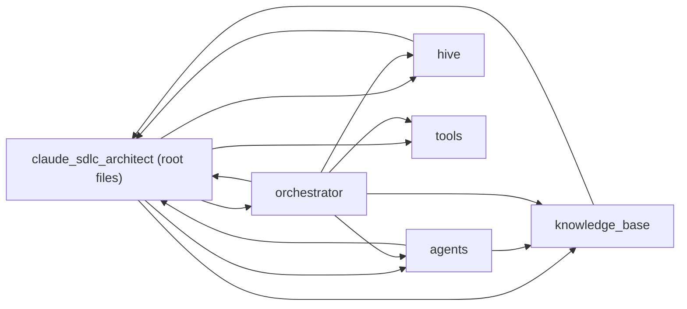

# Internal dependency map

`[Verified]` An edge A → B means files in A import code located in B (static imports only; dynamic imports are not seen).

| From | To | Importing files | Evidence |
|---|---|---|---|
| claude_sdlc_architect (root files) | agents | 2 | `desktop.py`, `streamlit_app.py` |
| claude_sdlc_architect (root files) | hive | 2 | `desktop.py`, `streamlit_app.py` |
| claude_sdlc_architect (root files) | knowledge_base | 3 | `cli.py`, `desktop.py`, `streamlit_app.py` |
| claude_sdlc_architect (root files) | orchestrator | 3 | `cli.py`, `desktop.py`, `streamlit_app.py` |
| claude_sdlc_architect (root files) | tools | 3 | `cli.py`, `desktop.py`, `streamlit_app.py` |
| agents | claude_sdlc_architect (root files) | 6 | `agents/_common.py`, `agents/design.py`, `agents/discuss.py` |
| agents | knowledge_base | 3 | `agents/design.py`, `agents/discuss.py`, `agents/requirement.py` |
| hive | claude_sdlc_architect (root files) | 3 | `hive/blackboard.py`, `hive/events.py`, `hive/memory.py` |
| knowledge_base | claude_sdlc_architect (root files) | 1 | `knowledge_base/loader.py` |
| orchestrator | claude_sdlc_architect (root files) | 1 | `orchestrator/graph.py` |
| orchestrator | agents | 1 | `orchestrator/graph.py` |
| orchestrator | hive | 1 | `orchestrator/graph.py` |
| orchestrator | knowledge_base | 1 | `orchestrator/graph.py` |
| orchestrator | tools | 1 | `orchestrator/graph.py` |

<!-- manual:begin notes -->
<!-- manual:end notes -->
